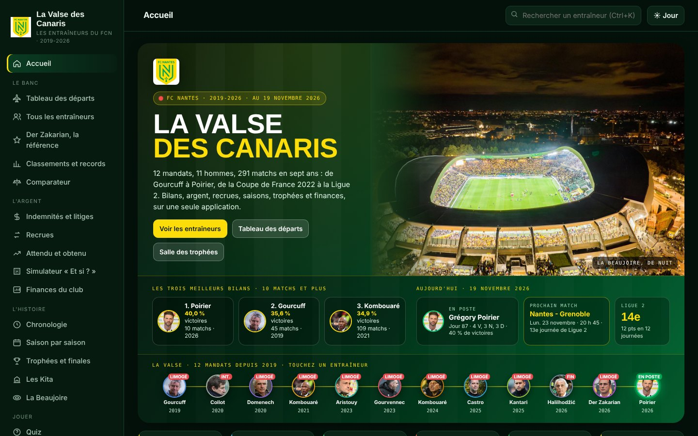
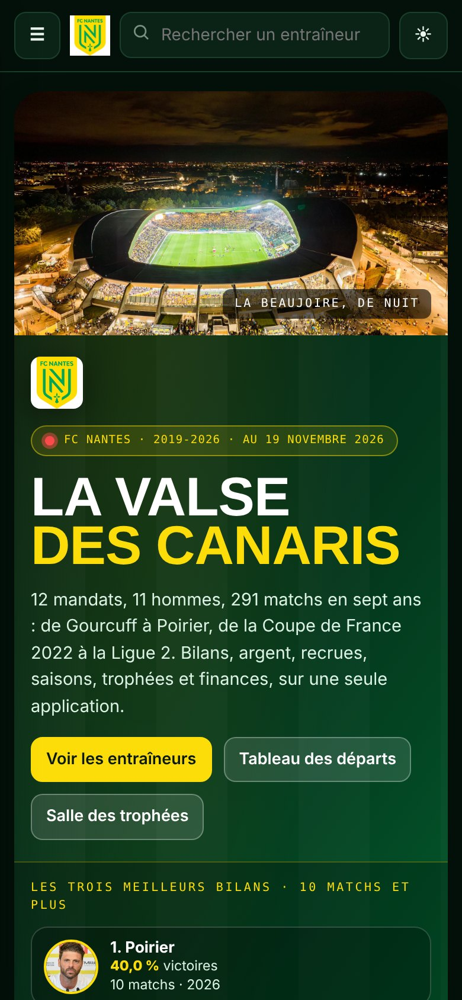
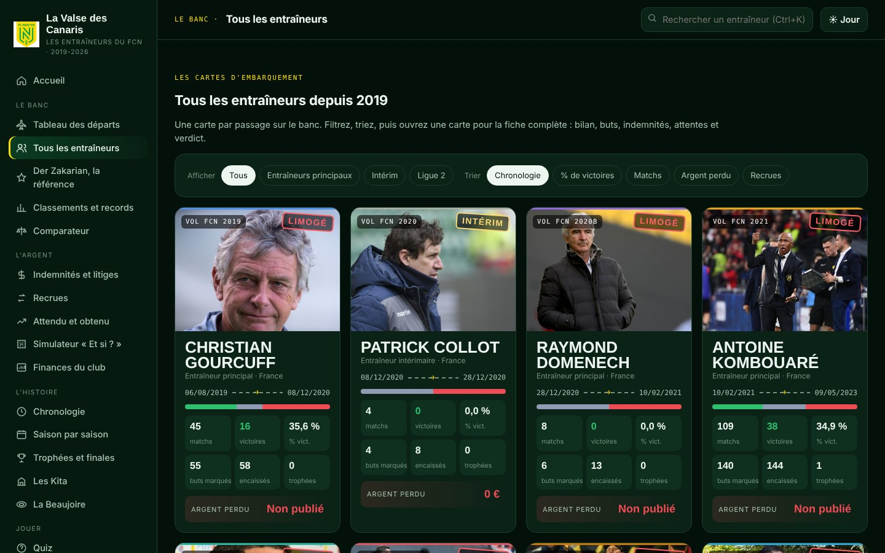
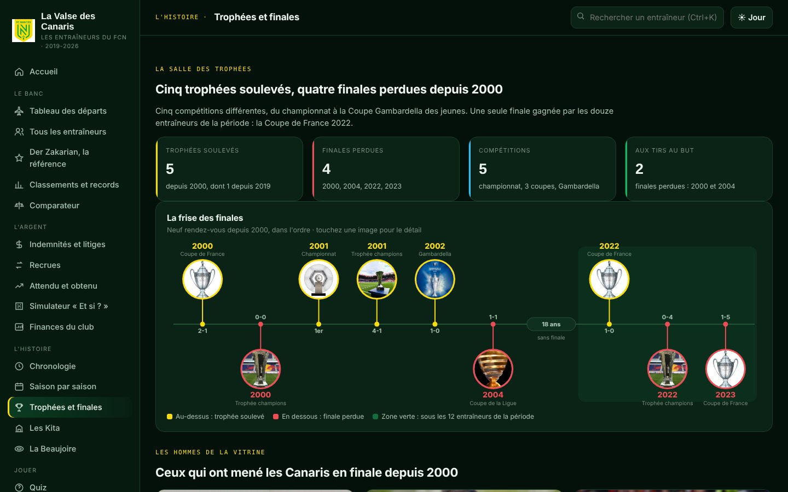

# ⚽ La Valse des Canaris · Les entraîneurs du FC Nantes depuis 2019

**12 mandats, 11 hommes, 291 matchs en sept ans** : de Christian Gourcuff à Grégory Poirier, de la Coupe de France 2022 à la Ligue 2. Bilans, argent, recrues, saisons, trophées et finances du FC Nantes, réunis sur une seule application.

👉 **Ouvrir l'application : [abdoulhamiddiallo.github.io/fc-nantes-entraineurs](https://abdoulhamiddiallo.github.io/fc-nantes-entraineurs/)**

---

## 📸 Aperçu

| Ordinateur | Téléphone |
|---|---|
|  |  |

| Les cartes d'embarquement | La salle des trophées |
|---|---|
|  |  |

---

## 📊 Les chiffres clés

| Indicateur | Valeur |
|---|---|
| Mandats sur le banc depuis août 2019 | **12** pour 11 hommes |
| Matchs dirigés | **291** (84 victoires, 78 nuls, 129 défaites) |
| Taux de victoires | **28,9 %**, contre 38,4 % pour Michel Der Zakarian en 2012-2016 |
| Durée moyenne d'un mandat terminé | **229 jours** |
| Buts | **343** marqués, **414** encaissés |
| Trophée de la période | **1** : la Coupe de France 2022 |
| Classement en Ligue 2 au 19 novembre 2026 | **14e**, 12 points en 12 journées |

---

## 🧭 Ce que contient l'application

- **Accueil** : la Beaujoire de nuit, le podium des meilleurs bilans, l'entraîneur en poste, le prochain match, la frise des 12 mandats et un carré par match joué.
- **Tableau des départs** : chaque mandat présenté comme un vol, avec décollage, atterrissage, jours en poste et statut.
- **Tous les entraîneurs** : une carte par passage sur le banc, filtrable et triable, et une fiche complète pour chacun (bilan, buts, indemnités, attentes, verdict).
- **Der Zakarian, la référence** : le mandat 2012-2016, le point de comparaison de l'ère Kita.
- **Classements et records**, **comparateur** entre deux entraîneurs.
- **Indemnités et litiges** : l'argent versé à l'arrivée et au départ, avec les montants jamais publiés signalés comme tels.
- **Recrues**, **attendu et obtenu**, **simulateur « Et si ? »**, **finances du club**.
- **Chronologie**, **saison par saison** avec le classement journée par journée en Ligue 2.
- **Trophées et finales** : cinq trophées soulevés et quatre finales perdues depuis 2000, dans cinq compétitions dont la Coupe Gambardella.
- **Les Kita** et **la Beaujoire**.
- **Quiz** et **sources et méthode**.
- Thème **jour et nuit**, recherche rapide, format **téléphone** soigné.

---

## 🛠️ Technique

- Une seule page HTML autonome (`index.html`) : HTML, CSS et JavaScript, sans dépendance.
- Graphiques dessinés en SVG, photos intégrées au fichier.
- Navigation par ancres, chaque fiche d'entraîneur a son propre lien.
- Publication gratuite par GitHub Pages.

---

## 📚 Sources

- Résultats match par match : ESPN, worldfootball.net et Wikipédia, toutes compétitions officielles, arrêtés au 19 novembre 2026.
- Classements : Ligue de football professionnel (LFP).
- Nominations, départs et montants publiés : Ouest-France, L'Équipe, RMC Sport, Foot Mercato, Maxifoot, AFP.
- Finances : comptes sociaux de la société FC Nantes (Pappers, Infonet), exercices 2022 à 2025.
- Finales depuis 2000 : FFF, worldfootball.net.

Les montants estimés sont signalés comme estimations, et les indemnités jamais rendues publiques sont affichées « Non publié ».

---

## 👤 Auteur

**Abdoul Hamid Diallo** · Microsoft Fabric Data Engineer · [LinkedIn](https://www.linkedin.com/in/abdoul-hamid-diallo-fabric-data-engineer/) · [Toutes mes applications](https://abdoulhamiddiallo.github.io/)
